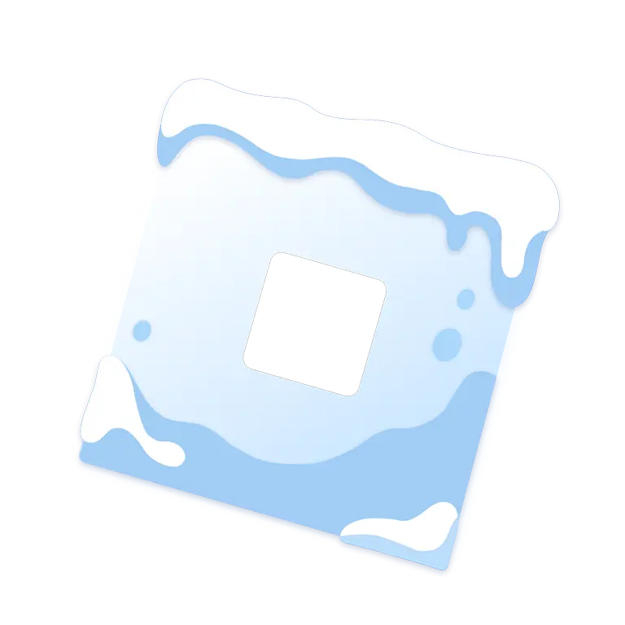

<h1 align="center">
    Froststrap
</h1>

    Froststrap is a cross-platform Roblox bootstrapper derived from <a href="https://github.com/fishstrap/fishstrap.git"><strong>Fishstrap</strong></a>.

    

    If you'd like to support our project, consider giving this repository a star!

[![License][badge-repo-license]][repo-license]
[![Downloads (Total)][badge-repo-downloads-total]][repo-releases]
[![Downloads (Latest)][badge-repo-downloads]][repo-releases]
[![Version][badge-repo-latest]][repo-latest]
[![Stars][badge-repo-stars]][repo-stargazer]
[![Discord][badge-discord]][discord-invite]

## Download

> [!NOTE]
> Windows doesn't have a `.exe` file: download instead the `.msi`.
> It is the modern way to install programs on your system and manage.

Every system (click to download the latest version):

| System | Download |
| :- | :- |
| Windows | [**Installer (.msi)**][download-windows], or run `winget install Froststrap.Froststrap` |
| macOS (Apple Silicon) | [**Installer (.pkg)**][download-macos-arm64] |
| macOS (Intel) | [**Installer (.pkg)**][download-macos-x64] |
| Debian, Ubuntu, Linux Mint, Pop!_OS | [**.deb**][download-linux-deb] |
| Fedora, RHEL, Nobara, Bazzite, Rocky, openSUSE | [**.rpm**][download-linux-rpm] |
| Arch, Omarchy, CachyOS, EndeavourOS | [**AUR**][download-linux-aur]: `yay -S froststrap-bin` |
| Universal Linux | [**.AppImage**][download-linux-appimage] |
| Nix | `nix run github:Froststrap/Froststrap` |

All files are also listed on the [latest release][repo-latest] page, under **Assets**.

> [!CAUTION]
> The official repository [Froststrap/Froststrap](https://github.com/Froststrap/Froststrap.git) and [our website](https://froststrap.xyz) are the **ONLY PLACES** where you should download the binary/executable. Any other source is **NOT** affiliated with us and poses a potential security threat.

## Platform Support

### Tier I

Tier I means we guarantee it works.
We support shipping binaries for these systems.

| System | Notes |
| :- | :- |
| Windows | Windows 10 LTSC or Windows 11 and above |
| macOS aarch64 >= 26.0 | Colloquially arm64. macOS 26 (Tahoe) and above |
| NixOS | All managed via wrapped binaries, so as long as you use our wrapper, it works correctly |

### Tier II

Tier II can be thought of as supported.
Binaries to be shipped, but support won't be as reliable due to less reproducibility or a higher maintenance burden.

| System | Notes |
| :- | :- |
| Arch Linux | Not known to be stable, so we will attempt to reproduce issues but assume they are Arch Linux issues |
| Other macOS | Any Mac system not covered is considered long gone, but if there is certain issues there is consideration |
| Fedora | No dependency list testing is available, so there is no guarantee the software will run without installing additional packages |
| Ubuntu/Debian | No dependency list testing is available, so there is no guarantee the software will run without installing additional packages |

### Tier III

| System | Notes |
| :- | :- |
| Anything not listed | We will try to help with issues, but in most cases, distro-specific issues or shortcomings will be vetoed or deprioritized in favor of more important work |

## Key Improvements Over Fishstrap

### Integrations
- Automatically rejoin servers you were disconnected from due to inactivity
- Disable Roblox’s built-in screenshot and video recording system
- Custom Froststrap Discord RPC that shows the current page/dialog
- Replace "Playing Roblox" with the name of the game you're playing using Custom Status Display
- The playtime counter shows both total and session playtime
- Roblox Studio RPC integrated within Froststrap
    * Change the Studio RPC thumbnail depending on the script that is open
    * Show script type, name, and number of lines of code

### Mods
- Multi-mod system that allows you to download many mods at once
- Select where to apply the mod (Player/Studio)
- Download community-made mods directly from within the app
- Generate mods using hex codes, with options to color the cursor, Shift Lock, or Emote Wheel
- Change the cursor, Shift Lock, death sound, and game font by selecting a file
- Use custom cursor sets to change between your cursors faster

### FastFlag Enhancements
- Automatic notification when applying FastFlags that are not in the Roblox FastFlag Allowlist
- Create or use FastFlag profiles
- Change all Roblox FastFlags in the allowlist via the FastFlag settings
- Click 'Clean List' to remove flags that are not in the Roblox FastFlag Allowlist

### UI & Appearance
- Fully customizable bootstrapper launcher
- Change the app font to any font you prefer
- Supports image and gradient background themes
- Built-in app themes
- Change the window background to Aero, Acrylic, or Mica

### Settings
- Easily switch Roblox update channels
- Option to fully block Roblox updates
- Replace Roblox’s changing version-xxxxx folders with a non-changing folder
- View all currently available Roblox channels

### Extra Features
- Easily import settings from other bootstrappers such as Fishstrap and Bloxstrap
- Create game shortcuts for faster game joining
- Join servers in your region more easily using the region selector
- Join servers in your selected region through the system tray while playing
- Built-in account manager

More features are planned! You can also suggest new features in the Issues section.

---

## Licensing

All new code revisions are under [MPL-2.0](https://opensource.org/license/MPL-2.0).

## Stargazing

To support the development of Froststrap, consider giving the repository a star.

<a href="https://www.star-history.com/?repos=Froststrap%2FFroststrap&type=date&legend=top-left">
 <picture>
   <source media="(prefers-color-scheme: dark)" srcset="https://api.star-history.com/chart?repos=Froststrap/Froststrap&type=date&theme=dark&legend=top-left" />
   <source media="(prefers-color-scheme: light)" srcset="https://api.star-history.com/chart?repos=Froststrap/Froststrap&type=date&legend=top-left" />
   
 </picture>
</a>

<!-- Badge defs -->
[badge-repo-license]: https://img.shields.io/github/license/Froststrap/Froststrap?style=for-the-badge&color=37add9
[badge-repo-downloads]: https://img.shields.io/github/downloads/Froststrap/Froststrap/latest/total?style=for-the-badge&color=37add9
[badge-repo-downloads-total]: https://img.shields.io/github/downloads/Froststrap/Froststrap/total?style=for-the-badge&color=37add9
[badge-repo-latest]: https://img.shields.io/github/v/release/Froststrap/Froststrap?style=for-the-badge&color=37add9
[badge-repo-stars]: https://img.shields.io/github/stars/Froststrap/Froststrap?style=for-the-badge&color=37add9
[badge-discord]: https://img.shields.io/discord/1364660238963179520?style=for-the-badge&label=discord&color=5865f2

[repo-license]: https://github.com/Froststrap/Froststrap/blob/main/LICENSE
[repo-actions]: https://github.com/Froststrap/Froststrap/actions
[repo-releases]: https://github.com/Froststrap/Froststrap/releases
[repo-latest]: https://github.com/Froststrap/Froststrap/releases/latest
[download-windows]: https://github.com/Froststrap/Froststrap/releases/latest/download/Froststrap-windows-x64.msi
[download-macos-arm64]: https://github.com/Froststrap/Froststrap/releases/latest/download/Froststrap-macos-arm64-Setup.pkg
[download-macos-x64]: https://github.com/Froststrap/Froststrap/releases/latest/download/Froststrap-macos-x64-Setup.pkg
[download-linux-aur]: https://aur.archlinux.org/packages/froststrap-bin
[download-linux-appimage]: https://github.com/Froststrap/Froststrap/releases/latest/download/Froststrap-linux-x64.AppImage
[download-linux-deb]: https://github.com/Froststrap/Froststrap/releases/latest/download/Froststrap-linux-x64.deb
[download-linux-rpm]: https://github.com/Froststrap/Froststrap/releases/latest/download/Froststrap-linux-x64.rpm
[repo-stargazer]: https://github.com/Froststrap/Froststrap/stargazers

[discord-invite]: https://discord.gg/KdR9vpRcUN
